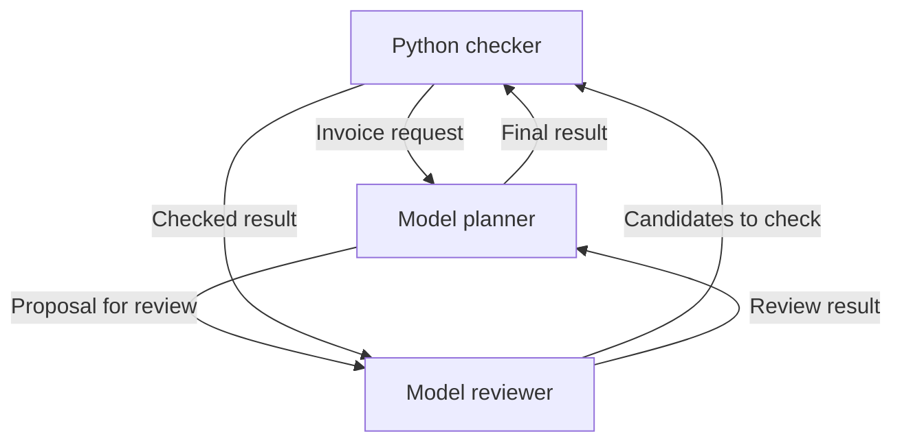

# Python reference host and Compose mesh

Run these commands from `emmett08/mas-reference-host`, after `make protocol`.

The Python host connects model and tool adapters to the existing Rust protocol.
Rust still owns encoding, route permissions, task transitions, call reservations,
expiry and durable storage. Python owns application scheduling and provider calls.
You can use the host as a library or run the supplied Compose example.

## Run without an API key

Install Docker Engine with Compose v2, or Docker Desktop, then run from the
repository root:

```sh
docker compose up --build --abort-on-container-exit --exit-code-from mesh
```

This builds the Rust binaries and Python host and runs a **mock** mesh. It makes
no provider requests. The mock adapters use the same Rust gateway, task flow and
call-accounting path as the live adapters. The final report labels the mode and
shows the checked result and communication events. Repeating this command creates
a new job. Use the explicit resume command below to recover an existing job.

## Run two GPT agents and a Python checker

Supply your OpenAI API key in the host shell. In Bash, this prompts without
echoing the key or putting its value into shell history:

```bash
read -rsp 'OpenAI API key: ' OPENAI_API_KEY
export OPENAI_API_KEY
docker compose -f compose.yaml -f compose.openai.yaml up --build --abort-on-container-exit --exit-code-from mesh
unset OPENAI_API_KEY
```

This explicitly selects live mode and makes paid API calls. Missing credentials
fail before any model request; live failures never silently switch to mocks.
Compose takes the key from the host environment and creates a private secret file
readable by the non-root host process. It does not add the key to the container
environment. The provider adapter reads that file; the key is never put in
protocol messages, model prompts or result reports. Other shells can set
`OPENAI_API_KEY` using their own secure input mechanism.

The mock service uses a read-only root filesystem. Compose requires a writable
root filesystem to install an environment-sourced secret, so the live override
enables that. The process still runs as UID 10001, with no added capabilities or
privilege escalation; application and system directories remain root-owned.

Copy `.env.example` to `.env` to change the model names. The defaults are
`gpt-4.1-mini` for the planner and `gpt-4o-mini` for the reviewer. Both support the
Responses API and structured outputs. Your account must have access to the
selected models. Model selection changes execution behaviour, not protocol
identity or routing permissions.

## Run Cursor, or mix Cursor and OpenAI

`compose.cursor.yaml` selects Cursor for both roles. `compose.mixed.yaml` selects
a Cursor planner and an OpenAI reviewer. Both use the optional glibc image;
the SDK's bundled native bridge is not supported by the default Alpine image.
The complete secret setup and commands are in [providers](providers.md).

The provider factory also supports independent native settings:
`MAS_PLANNER_PROVIDER` and `MAS_REVIEWER_PROVIDER`, each set to `mock`, `openai`
or `cursor`. Use `--mode mixed` when specifying both roles. Each role can select
its own model and reservation. `--mode mock` always stays offline, ignoring
live-provider settings. `--mode openai` and `--mode cursor` supply provider
defaults that explicit per-role settings may override. Cursor requires an
explicit account-supported model.

Cursor's restricted local adapter implements the same `TotalProvider` contract
as OpenAI. Cursor Cloud has a separate repository-job adapter: it returns a
durable submission receipt and exposes explicit status, reconciliation and
cancellation operations. Remote work can continue after the local task expires.
See the [durable-job workflow](providers.md#durable-cursor-cloud-jobs) before
submitting repository work.

## What the example does

The task is deliberately easy to check: calculate an invoice total in integer
cents. This demonstrates communication and independent validation, not a claim
that several models improve arithmetic or outperform one model.

| Actor | Adapter in live mode | Responsibility |
|---|---|---|
| `planner` | OpenAI or restricted local Cursor | Propose the invoice total, then request peer review. |
| `reviewer` | Independently selected OpenAI or restricted local Cursor | Assess the invoice and proposal, then ask the checker to validate them. |
| `checker` | Deterministic Python | Recompute the exact total and report whether the candidates agree with it. |



All six directed edges in `examples/host/mesh.json` carry messages. Every
delegation creates its own task and request identity. Results correlate with
the original request, and the Rust gateway admits each operation under the
appropriate actor capability. There is no shared conversation history between
the model roles; each sees its addressed task data and its own fixed instructions.

This is a **logical mesh on a central durable transport**. Compose runs one
trusted host container, with a Rust gateway subprocess and separate model calls.
It does not provide peer-to-peer network transport or isolate arbitrary Python
plugins from one another. The base demo publishes no ports. The optional
[bridge deployment](bridges.md) exposes authenticated MCP, A2A and task-service
endpoints through a separate ingress process and durable worker.

## Write an adapter

Install Python 3.10 or newer on Linux and the Rust binaries, then install the host:

```sh
cargo build --release --locked --manifest-path .protocol/rust-protocol/Cargo.toml --target-dir "$PWD/rust-protocol/target"
python -m pip install ./host
export PATH="$PWD/rust-protocol/target/release:$PATH"
```

For native OpenAI execution, also install the pinned SDK dependencies:

```sh
python -m pip install --require-hashes -r host/requirements-openai.txt
```

An adapter implements one method. The host provides the addressed request and an
actor-bound `AdapterContext` interface: `actor`, `invocation_id`,
`remaining_seconds`, `request` and `invoke`. Parent-only checkpoint/admission
methods are outside that interface. The following complete example needs no model provider:

```python
from pathlib import Path
from mas_host import Outcome, Runner

class Uppercase:
    def handle(self, context, request):
        if request.operation != "uppercase":
            raise ValueError("unsupported operation")
        return Outcome({"text": request.input["text"].upper()})

topology = {
    "agents": ["client", "worker"],
    "edges": [["client", "worker"], ["worker", "client"]],
    "application": "agent-task/1",
    "mailbox_capacity": 10,
    "max_messages": 20,
    "max_bytes": 65536,
    "max_calls": 4,
    "wall_seconds": 120,
}

with Runner(topology, {"client": Uppercase(), "worker": Uppercase()},
            state_dir=Path(".mas-state"), workflow_version="uppercase/1") as runner:
    result = runner.request("client", "worker", "uppercase", {"text": "hello"})
    print(result.output)
```

Use `context.request(peer, operation, input)` inside a handler to delegate work.
It sends and consumes a real Request/Result exchange. A peer reply needs the
reverse directed edge as well as the request edge. All requests and replies go
through the Rust encoder and authenticated gateway.

A handler can catch a delegated `AdapterError` and choose a deterministic
fallback. Inline and supervised execution preserve that public error contract.
Unknown invocation outcomes still prevent completing the affected workflow:
catching an exception cannot turn an uncertain effect into confirmed success.

Wrap every external effect with `context.invoke(callable, input=effect_descriptor,
reservation_microusd=100000)`. The zero-argument callable returns
`Invocation(output={...}, evidence={...})`. Include every effect-relevant input,
provider/model binding and adapter version in the descriptor. The parent records
a durable intent, deployment allocation and Rust call reservation before giving
the adapter permission to execute. Record a conservative allocation in micro-US
dollars (100000 = $0.10); it is an admission allowance, not a provider invoice or
a guarantee about eventual billing. Mock adapters use zero money allocation but
still consume the shared call count. Custom adapters are trusted to declare
appropriate allowances and to keep all effects inside this interface.

The invoice demo's `TotalProvider` contract requires `total(...)`,
`descriptor()` and an integer `reservation_microusd`, including an explicit zero
for offline providers. Descriptors identify provider, model, contract and all
effect-relevant configuration, without credentials. Binding is validated before
run admission; missing metadata never implies free execution or a class-name
identity. Existing built-in provider bindings retain their recovery identity.

During the callable, `context.invocation_id` supplies a stable diagnostic ID and
`context.remaining_seconds` exposes the remaining run deadline. The OpenAI
adapter sends the ID as `X-Client-Request-Id`, records safe response/request IDs
and token counts, and disables SDK retries. This diagnostic header is not a
provider idempotency guarantee.

The Cursor adapter records the diagnostic ID locally and retains safe agent/run
identifiers. It disables bridge RPC retries; the pinned SDK may retry model
requests internally. One admitted MAS invocation therefore means one submitted
agent run, not a guaranteed single underlying model request. Neither provider
has an automatic fallback to another provider after an uncertain failure.

Adapters run in supervised child processes by default. The parent retains the
gateway, checkpoints and accounting. Its watchdog uses the original run deadline to stop and reap local work,
including nested delegation. Blocked host/storage calls and OS scheduling can
delay enforcement; this is not a hard real-time guarantee. A separate Linux
guardian observes the host's lifetime pipe and the same absolute deadline. It
retains run ownership until it has killed and reaped the adapter process group,
including ordinary descendants after host `SIGKILL`. Adapter workers do not
inherit the host's database or run-lock descriptors. Local termination cannot
establish that remote provider work stopped.
This requires a single-threaded Linux host; Docker supplies Linux on other hosts.

The interface accepts trusted Python code, not hostile plugins. Processes share
the container's filesystem and trust boundary; this is not a security sandbox.
Ordinary background descendants are cleaned up, but adapters must not daemonise
or escape their process group. Model output is data: the example never executes
generated Python, shell commands or model-selected tools.

Acquire process-bound resources, such as open files and network connections,
inside `handle` or `invoke`; copied host descriptors are deliberately closed in
adapter workers. Each active delegation level uses a guardian and an adapter
worker in addition to the host's short-lived protocol subprocesses. Set PID and
memory limits for the configured maximum delegation depth.

## Reuse across topologies

| Topology | Configuration and workflow |
|---|---|
| Star | Permit hub↔worker pairs; the hub calls each worker adapter. |
| Mesh | Permit the peer pairs required by the workflow; adapters delegate directly. |
| Tree | Permit parent↔child pairs; a lead adapter delegates to its children. |
| Pipeline or review loop | Permit stage/reviewer pairs, including reply edges; bound delegation depth and rounds. |

Topology does not select adapters or schedule work by itself. Bind every actor
to an adapter and supply the application workflow. Membership, routes and runtime
budgets are frozen for each run. This runner schedules requests synchronously;
it supports bounded nested delegation, not concurrent fan-out or a distributed
worker pool. The existing Rust fixtures demonstrate additional workflow patterns.

## Persistence and explicit recovery

Compose retains private run directories and a deployment ledger in its named
state volume. A run contains Rust `state.sqlite`, host `host.sqlite`, capability
configuration and the report. This is sensitive application state. Removing a
container preserves it; `docker compose down --volumes` deletes it.

To resume the default mock mesh, substitute the run directory printed by the previous
report. Keep the original mode, invoice, topology, provider models and allocation:

```sh
docker compose run --rm mesh --mode mock --state-dir /state --topology /app/examples/host/mesh.json --resume /state/RUN_DIRECTORY
```

For a library workflow use `Runner.resume(run_dir, adapters,
workflow_version="uppercase/1")`, then repeat the original `runner.request(...)`
calls in their original order. Use an explicit workflow version and change it
when application behaviour changes. Resume rejects changed versions, depth limits
and checkpoint inputs. The demo also binds recovery to its provider configuration.
Completed root requests return their stored results. Incomplete adapters rerun
deterministic orchestration code, receiving cached invocation outputs instead of
repeating those effects. Randomness, mutable external state and effects outside
`context.invoke` break that recovery contract.

New runs publish a durable bootstrap intent before deployment admission.
`Runner.resume` can finish interrupted initialisation using the original run
identity, workflow version, topology and any already committed Rust deadline.
Published gateway credentials are reused. No adapter runs before bootstrap is
ready. Complete legacy runs remain readable through validated schema migration;
an incomplete legacy run without its original workflow metadata remains
unresolved because that missing identity cannot be reconstructed safely.

An invocation that may have reached a provider is retained as **unknown** and
blocks automatic re-execution. Inspect the journal and provider records, then use
an evidence-backed administrative resolution: supply an independently established
completed output, or confirm that no effect occurred before authorising a new,
separately charged attempt. The software cannot prove the truth of that operator
evidence. See the exact commands in [operations](operations.md). A new Runner or
fresh Compose job is a new business operation and may repeat the same real-world
effect; equal JSON is not a global business idempotency key.

Acknowledgements follow durable terminal outcomes. Sanitised local adapter
failures may close a task; uncertain invocation failures leave it recoverable
until resolution or the original deadline. Expiry never extends on restart and
cannot be undone by resolution. A protocol failure or expiry cannot prove absence
of external effects.

## Deployment controls and evidence

The [operations guide](operations.md) covers shared quotas, health, independent
reconciliation, retention and consistent backups. Restores are admission-disabled
audit copies: they cannot spend from a stale budget snapshot. The optional
`compose.production.yaml` adds an independent reconciler; CPU, memory and PID caps
are applied by Compose. This is a bounded single-host service, not high availability.

See [host architecture](host-architecture.md) for responsibility boundaries,
interface contracts and the design choices behind these controls.

[Deployment acceptance](deployment-acceptance.md) provides actual crash, storage
failure, bounded load/soak and opt-in live-provider checks. [Release controls](releases.md)
cover hash-locked dependencies, image digests, security scans and release artefacts.
Offline SDK and Compose checks do not establish live account availability, billing,
model quality or external exactly-once execution. SPIN checks the documented finite
protocol and recovery models; it does not verify Python, Docker or either
provider SDK. The [Cursor job model](https://github.com/emmett08/mas/blob/main/formal/cursor-jobs-notes.md) covers
bounded launch, correlation and cancellation safety separately from local
provider execution.

## API and packaging references

- [OpenAI Responses API](https://developers.openai.com/api/reference/python/resources/responses)
- [OpenAI structured outputs](https://developers.openai.com/api/docs/guides/structured-outputs)
- [GPT-4.1 mini](https://developers.openai.com/api/docs/models/gpt-4.1-mini)
- [GPT-4o mini](https://developers.openai.com/api/docs/models/gpt-4o-mini)
- [Docker Compose secrets](https://docs.docker.com/compose/how-tos/use-secrets/)
- [Cursor Python SDK](https://cursor.com/docs/sdk/python)
- [Cursor Cloud Agents API](https://cursor.com/docs/cloud-agent/api/endpoints)

These references were consulted on 14 October 2026. Credentials are supplied at
runtime, never during image construction.
